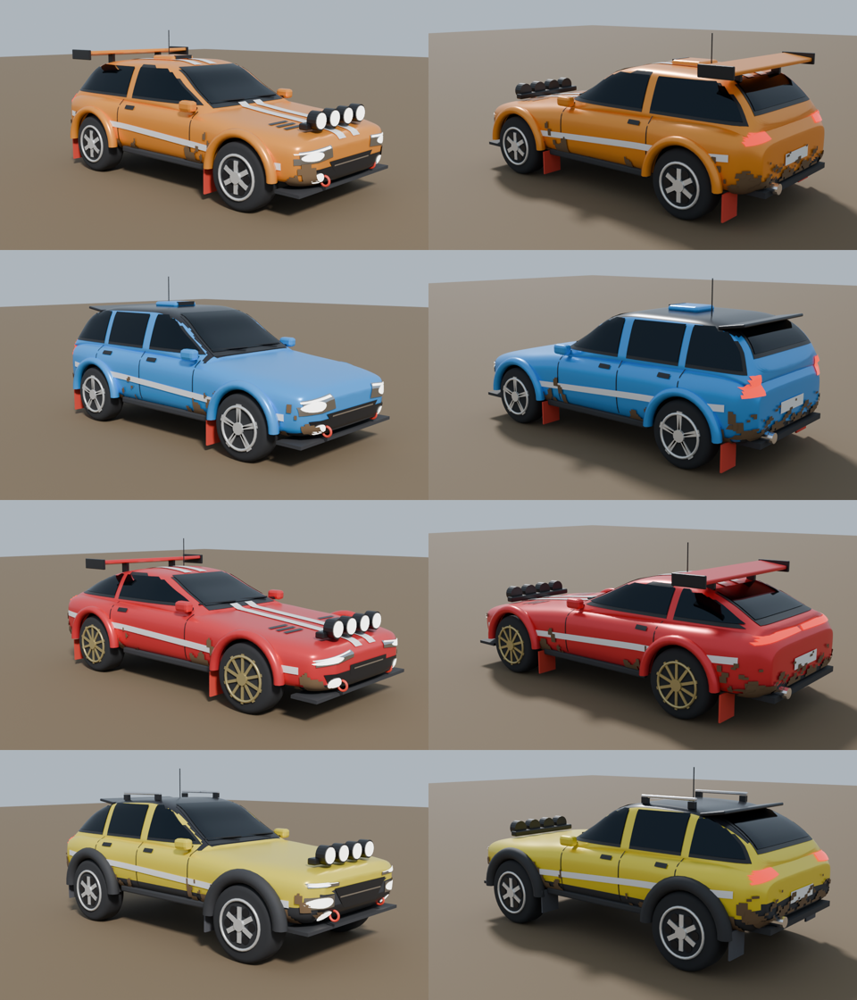

# Mud Rally

A rally racing game in a single HTML file: Three.js, WebRTC multiplayer, computer opponents and four rally cars modelled in Blender.



## Play

- **Online:** after the GitHub Pages deploy (below) it lives at `https://<your-user>.github.io/<repo>/`.
- **Offline:** open `index.html` in Chrome, Edge or Firefox. The cars are embedded in the file; Three.js and the Draco decoder load from a CDN, so you need internet access the first time.

Controls: `W`/`↑` throttle, `S`/`↓` brake and reverse, `A` `D` steer, `Space` handbrake, `R` back on the road, `C` camera, `M` sound. Phones get on-screen pedals.

### Multiplayer

Peer-to-peer over WebRTC, with no game server. The host clicks **Host a race** and sends the invite code to a friend; the friend pastes it under **Join a race** and sends back the reply code; the host pastes that and clicks **Connect**. Up to 4 players, plus computer cars. Very strict networks (some offices and mobile carriers) need a TURN relay, which this project doesn't include.

## Cars

| Car | Style |
| --- | --- |
| Hatch R5 | 3-door hot hatch, big wing, light pod |
| Supermini 5D | 5-door supermini, black roof, roof spoiler |
| Coupe GT | Low coupé with long bonnet, gold mesh wheels |
| Crossover RX | Raised crossover, plastic cladding, roof rails |

The designs are original and carry no manufacturer branding.

They are generated by `blender/build_cars.py`. Each design is a block of numbers in its `CARS` dictionary: body profile curves, roofline, wheel positions, door and pillar positions, light-cluster shapes and rally kit. Windows, lights, stripes and mud are projected onto the body, so their edges stay clean.

Material names the game relies on: `Paint` (recoloured per car), `Stripe`, `Roof`. Wheel objects: `WheelFL`, `WheelFR`, `WheelRL`, `WheelRR`.

### Rebuild the cars

```bash
pip install bpy            # Blender as a Python module (or run the scripts with Blender's own Python)
./tools/build_models.sh    # model -> Draco-compress -> thumbnails -> embed into index.html
```

`tools/embed_models.py` alone re-embeds `models/*.glb` and `models/thumb_*.jpg` into `index.html`, for example after you edit a `.blend` file and export it yourself.

## Deploy to GitHub Pages

1. Push this repo to GitHub (branch `main`).
2. Go to **Settings → Pages → Build and deployment → Source** and choose **GitHub Actions**.
3. Every push to `main` runs `.github/workflows/deploy.yml` and publishes the site. You can also run it by hand from the **Actions** tab.

`.github/workflows/build-models.yml` is a manual workflow. It rebuilds the cars in CI from the Blender script and commits the results, which then triggers a deploy.

## Layout

```
index.html                 the game (cars embedded between <!--MODELS--> markers)
models/                    Draco-compressed car GLBs, thumbnails, preview
blender/                   car generator, thumbnail renderer, .blend sources
tools/                     build_models.sh, embed_models.py
.github/workflows/         deploy.yml (Pages), build-models.yml (manual rebuild)
```
# mud-rally
